<p align="center">
  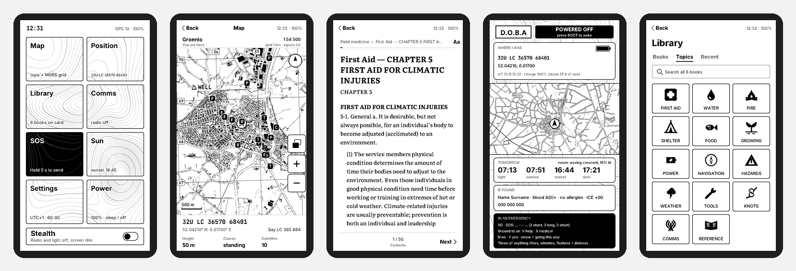
</p>

<h1 align="center">D.O.B.A — Доба</h1>
<p align="center"><b>Durable Offline Backcountry Assistant</b><br>
An e-ink pocket device that keeps working when the internet, the phone network and the power grid don't.</p>

<p align="center">
  <a href="#hardware--where-to-buy">Hardware</a> ·
  <a href="#features">Features</a> ·
  <a href="#screens">Screens</a> ·
  <a href="#getting-started">Getting started</a> ·
  <a href="docs/Doba.pdf">PDF overview</a> ·
  <a href="README.uk.md">Українською</a> ·
  <a href="https://github.com/sponsors/festchenko">Support ♥</a>
</p>

---

Doba is firmware and a data pipeline for the **LilyGo T5 E-Paper S3 Pro**: a 4.7″ touch e-ink board with GPS and a LoRa radio. Put a microSD card in it with maps of Europe, a survival-oriented library and terrain heights, and it gives you:

- **topographic maps with a military grid (MGRS)**, your position, points and places nearby;
- **an offline library**: Wikipedia with pictures, field medicine, repair guides, field manuals, classics, dictionaries and your own EPUB/PDF books;
- **text messaging without any network** over LoRa, compatible with **Meshtastic**;
- **a paper card when switched off**: e-ink keeps the image with no power, so the off screen shows where you were, tomorrow's daylight, an *if found* card and an emergency crib.

There is no account, no cloud, no app, and nothing transmits unless you switch the radio on. Bluetooth and Wi-Fi are off by default.

> **Status:** personal project, in active use. Built and tested on the simulator and on real hardware (H752-01). The interface is in **English and Ukrainian**.

## Features

| | |
|---|---|
| **Maps** | Vector topographic tiles drawn for 4-grey e-ink: roads, buildings, forests, water, contour lines from a DEM, hillside heights. North-up or course-up, from street level to the whole country. Most of Europe plus Ukraine, built region by region. |
| **Navigation** | MGRS position with 1 m digits, latitude/longitude, magnetic declination, azimuth in mils (6000 UA or 6400 NATO) and degrees. A measuring cross: distance and compass azimuth from you or from point A, ground height and water depth under it. |
| **Points & places** | Save points from GPS, from the map or typed as MGRS; "go here" with distance and azimuth. Nearby: hospitals, doctors, pharmacies, water, food shops, farms, shelters, bunkers, underground parking, all from OpenStreetMap, offline. |
| **Library** | Kiwix ZIM archives converted to a light format the ESP32 reads quickly: Wikipedia (EN, UK) with pictures, WikiMed, iFixit, Appropedia, Stack Exchange Q&A, Wikisource and Gutenberg classics, Wikivoyage, Wiktionary, US field manuals, plus your own PDF/EPUB/Markdown. Topic pages (first aid, water, fire, shelter, food…) and three emergency buttons. |
| **Reader** | Serif text with Cyrillic hyphenation, pictures and captions, contents, links and back, text size. Long books **reopen where you stopped**, even after a restart. |
| **Comms** | LoRa SX1262, Meshtastic-compatible channels and direct messages, node list with distance and bearing, quick phrases, an on-screen keyboard (EN/UA). **SOS** repeats your MGRS position on the mesh every 5 minutes. |
| **Stealth** | One switch: radio silent (or listen-only), light off, screen dim. |
| **Sun & moon** | Sunrise, sunset, civil twilight, daylight left and moon phase, offline. |
| **Battery** | Measured current and time left at this pace, and an estimated split of where the charge goes (GPS, radio, light, screen updates). |
| **Power** | Switched off from the menu, the battery is fully disconnected (ship mode), so the device keeps for months and starts with the POWER key. |
| **Off screen** | MGRS and coordinates where it was switched off, time and charge, a map, tomorrow's light, the *if found* card and an emergency crib (112, SOS in Morse, ground-to-air signals, rule of three). |
| **Library management** | Delete a whole book from its page to free space on the card. |

## Screens

<table>
<tr>
<td align="center">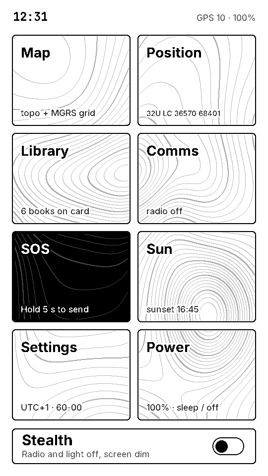<br>Home</td>
<td align="center"><br>Topo map + MGRS</td>
<td align="center">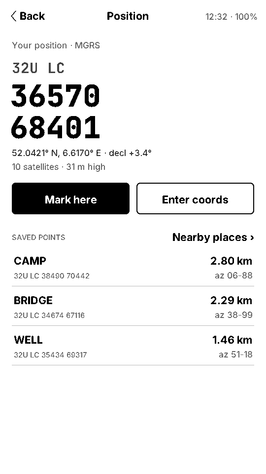<br>Position &amp; points</td>
<td align="center">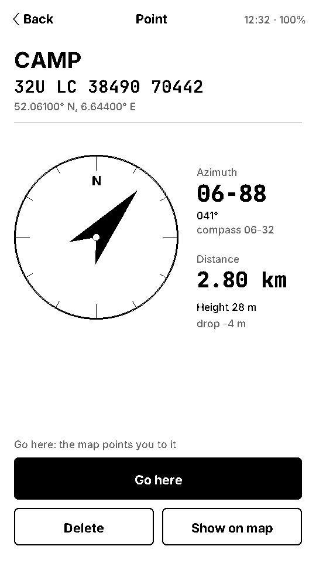<br>Go to a point</td>
</tr>
<tr>
<td align="center">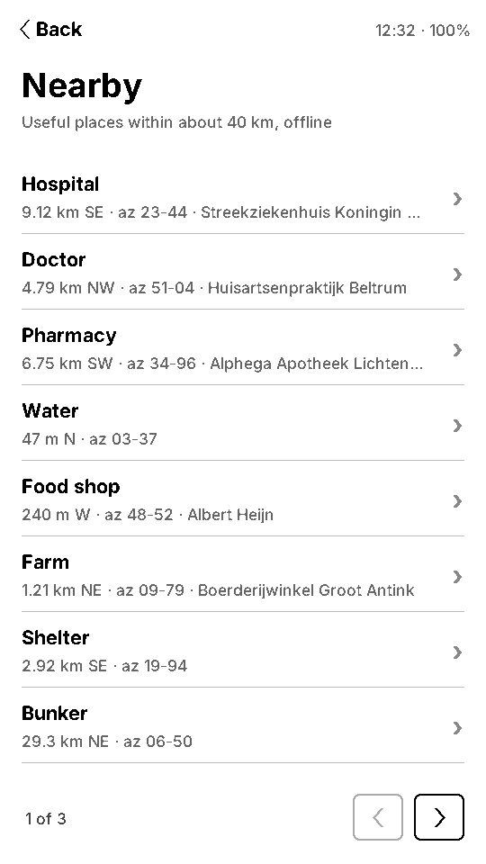<br>Places nearby</td>
<td align="center">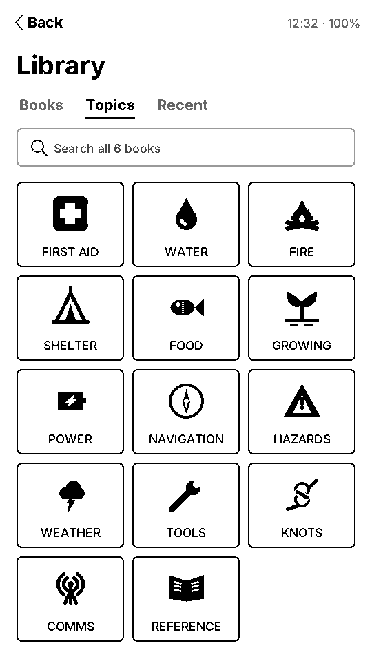<br>Library topics</td>
<td align="center">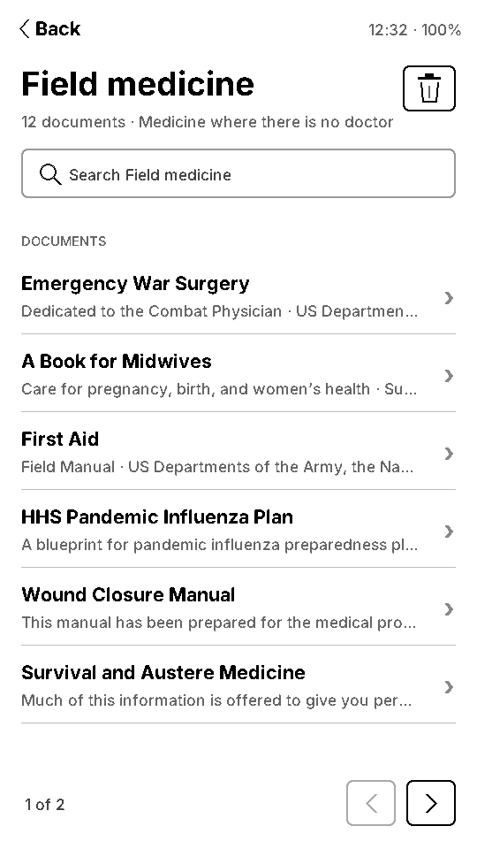<br>A book</td>
<td align="center">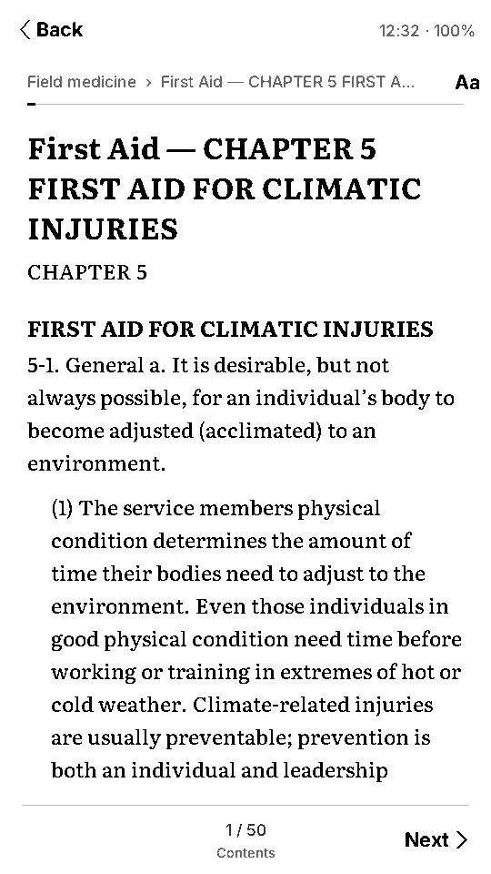<br>Reader</td>
</tr>
<tr>
<td align="center">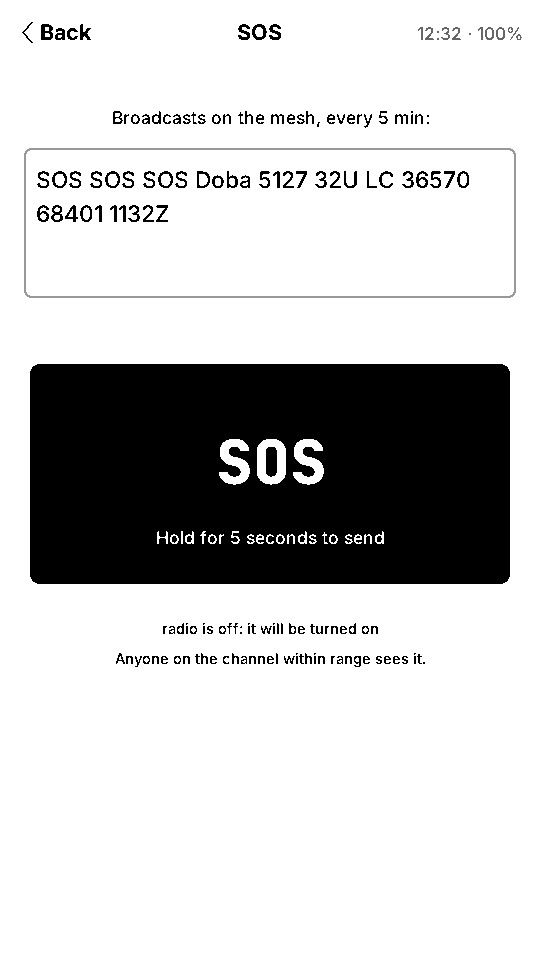<br>SOS over LoRa</td>
<td align="center">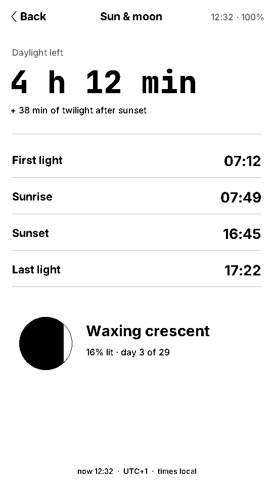<br>Sun &amp; moon</td>
<td align="center">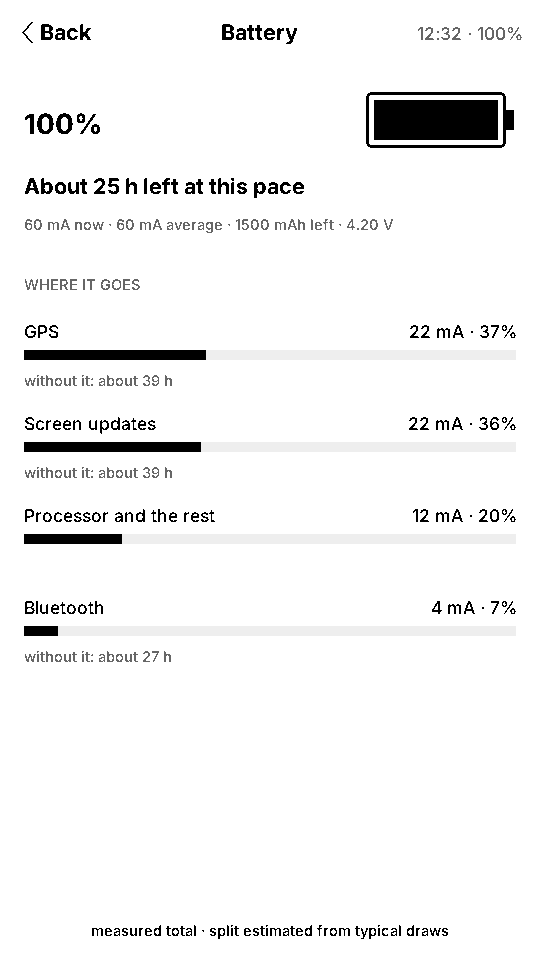<br>Battery</td>
<td align="center">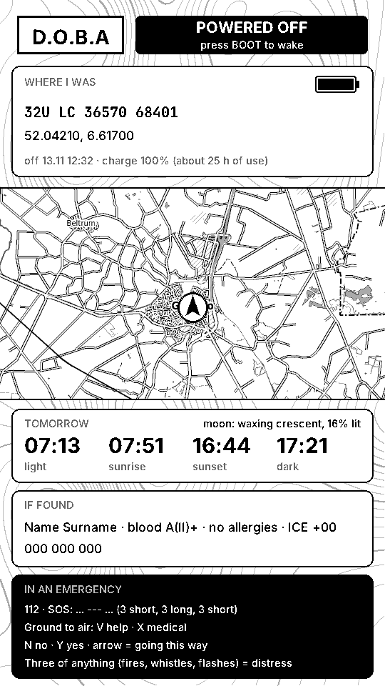<br>Power-off card</td>
</tr>
<tr>
<td align="center">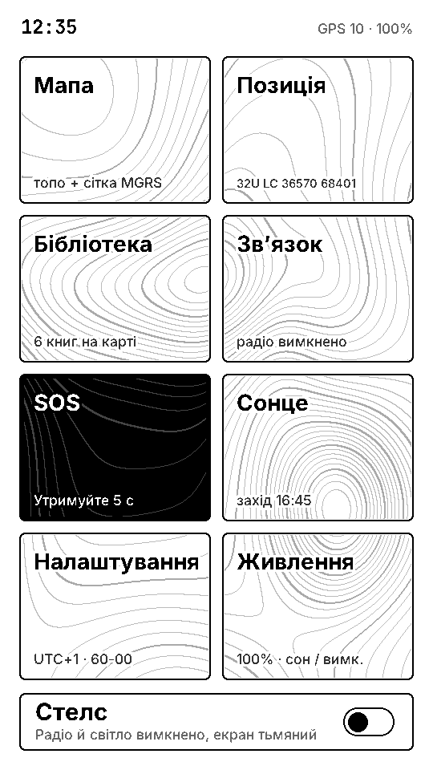<br>Українською</td>
<td align="center">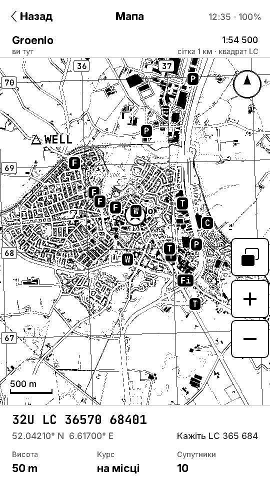<br>Мапа</td>
<td align="center">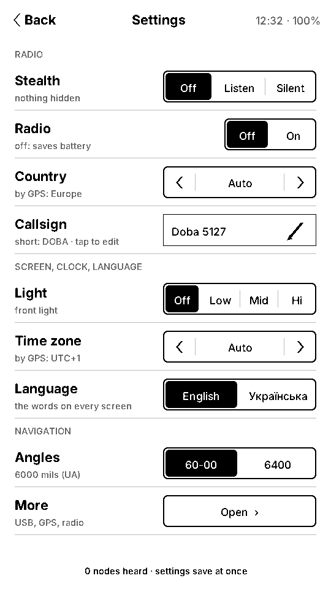<br>Settings</td>
<td align="center">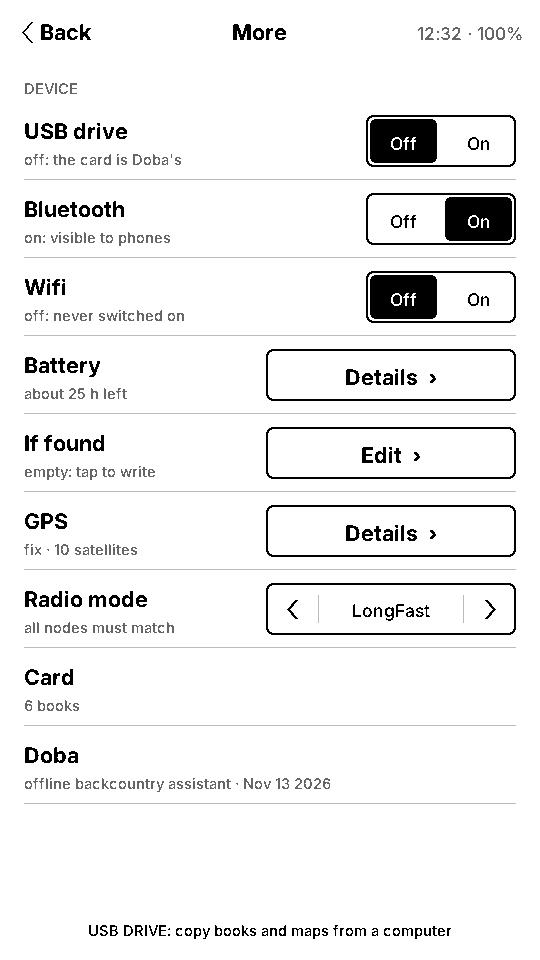<br>Device</td>
</tr>
</table>

Screens are rendered by the firmware itself, compiled for the desktop simulator (`firmware/sim`), with a real map of Groenlo (NL).

## Hardware & where to buy

| Part | Notes | Where |
|---|---|---|
| **LilyGo T5 E-Paper S3 Pro** (H752-01) | ESP32-S3, 16 MB flash, 8 MB PSRAM, 4.7″ 960×540 touch e-ink, GPS, SX1262 LoRa, 1500 mAh battery, RTC. **Pick the version with GPS and the LoRa band for your region** (868 MHz in Europe/Ukraine, 915 MHz in the Americas). | [LilyGo store](https://lilygo.cc/products/t5-e-paper-s3-pro) · [Tindie](https://www.tindie.com/products/lilygo/lilygo-t5-e-paper-s3-pro/) · LilyGo's official AliExpress store |
| **microSD card**, 256 GB – 1 TB | Formatted **FAT32** (the scripts do it). Any A1/A2 card works: the device reads over SPI, so speed class barely matters; a faster card only shortens the copy from the computer. | Any shop |
| *Optional:* a second Meshtastic node | To message with Doba, or as a relay on a windowsill, e.g. a Heltec V3 (868 MHz). | Any Meshtastic seller |

## Getting started

### 1. Flash

Prebuilt images are in [`release/`](release). With Python and `esptool`:

```bash
pip3 install esptool
python3 -m esptool --chip esp32s3 write-flash 0x0 release/doba-full.bin
```

On a Mac, `tools/flash-mac.sh` backs up the factory firmware first and then flashes. If the port isn't found: hold **BOOT**, press **RST**, release **BOOT**.

### 2. Build the card

Everything on the card is made from open data by the scripts in this repo, on any Mac or Linux machine with Python 3 and enough disk space (≈1 TB for all of Europe and the full library):

```bash
# maps: OSM + terrain -> 4-bit e-ink tiles, per region (maps/regions/*.env)
DOBA_BUILD=/Volumes/SSD/doba maps/make-region.sh netherlands
# library: download Kiwix ZIMs and convert them (list at the top of the script)
DOBA_BUILD=/Volumes/SSD/doba library/fetch_zims.sh && library/fetch_zims.sh convert
# your own books: PDF, EPUB, HTML, Markdown
python3 library/docs2doba.py ~/Books /Volumes/SSD/doba/lib/my_books --name "My books"
# format the card (FAT32) and copy maps, heights and books
tools/prepare-sd-mac.sh list
tools/prepare-sd-mac.sh format diskN
tools/prepare-sd-mac.sh all /Volumes/SSD/doba
```

Detailed notes (in Russian) are in [`docs/build-notes.ru.md`](docs/build-notes.ru.md).

### 3. Use

| Button | Short press | Hold |
|---|---|---|
| **BOOT** | Home | 1.5 s: power menu (switch off) |
| **IO48** (side) | Front light | |
| **POWER** | Switch on after a power-off | |
| **RST** | Restart | |

## Repository

```
firmware/   the device: fork of OpenTrailPaper (Apache-2.0) + Doba's screens, maps, library, comms
firmware/sim  the firmware compiled for the desktop, with tests (pytest) and screenshots
maps/       map pipeline: OpenStreetMap + DEM -> packed 4-bit tiles, places, heights
library/    ZIM / PDF / EPUB / HTML -> Doba books, topic menus, cleanup and audit
tools/      flashing and card preparation on a Mac
release/    prebuilt firmware images
```

## Credits & licenses

- Firmware is a fork of **[OpenTrailPaper](https://github.com/RaemondBW/OpenTrailPaper)** by Raemond Bergstrom-Wood, **Apache License 2.0** (see [`firmware/LICENSE`](firmware/LICENSE) and [`firmware/NOTICE`](firmware/NOTICE)). Doba's own code is under the same license.
- Map data © **OpenStreetMap** contributors, ODbL. Terrain from public DEMs (Copernicus / SRTM).
- Library content comes from **Kiwix** archives of Wikipedia, Wikisource, Wikivoyage, Wiktionary, WikiMed, iFixit, Appropedia, Stack Exchange and Project Gutenberg, each under its own license (CC BY-SA, CC BY-NC-SA, public domain). **No content is included in this repository.** You build the card yourself from the sources.
- Meshtastic is a trademark of Meshtastic LLC; Doba speaks its open protocol and is not affiliated.

Doba is not a certified safety or medical device. Carry a phone, a paper map and a compass too.

## Support

If Doba is useful to you, you can support its development through **[GitHub Sponsors](https://github.com/sponsors/festchenko)**. Issues and pull requests are welcome.
