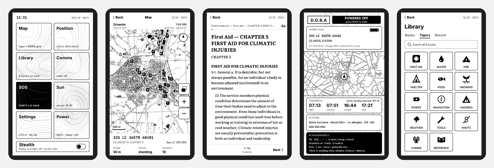

  

<h1 align="center">Доба — D.O.B.A</h1>

<b>Durable Offline Backcountry Assistant</b> 
Кишеньковий пристрій на e-ink, який працює, коли немає ні інтернету, ні мобільного зв'язку, ні світла.

  <a href="README.md">English</a> ·
  <a href="docs/Doba.pdf">PDF-огляд</a> ·
  <a href="https://github.com/sponsors/festchenko">Підтримати ♥</a>

---

Доба — це прошивка і конвеєр даних для плати **LilyGo T5 E-Paper S3 Pro**: сенсорний e-ink 4,7″, GPS і радіо LoRa. Вставляєте microSD з мапами Європи, бібліотекою та рельєфом і отримуєте:

- **топографічні мапи з сіткою MGRS**, свою позицію, точки та корисні місця поруч;
- **офлайн-бібліотеку**: Вікіпедія з картинками, польова медицина, ремонт, польові настанови, класика, словники і ваші власні EPUB/PDF;
- **текстові повідомлення без жодної мережі** через LoRa, сумісно з **Meshtastic**;
- **паперову картку, коли пристрій вимкнено**: e-ink тримає зображення без живлення, тож на екрані лишаються місце, де ви були, світловий день на завтра, картка «якщо знайшли» та пам'ятка на крайній випадок.

Жодних акаунтів, хмари чи застосунків. Нічого не передається в ефір, доки ви самі не ввімкнете радіо. Передавати може тільки радіо: Bluetooth і Wi-Fi у прошивці немає взагалі.

## Можливості

- **Мапи:** дороги, будівлі, ліси, вода, горизонталі, висоти; північ угорі або за курсом.
- **Навігація:** MGRS з точністю до 1 м, широта/довгота, магнітне схилення, азимут у тисячних (60-00 або 64-00). Хрестик вимірювання: відстань і азимут від вас або від точки A, висота й глибина під ним.
- **Точки й місця:** точки з GPS, з мапи або введені як MGRS; «йти сюди». Поруч: лікарні, лікарі, аптеки, вода, магазини, ферми, укриття, бункери, підземні паркінги — з OpenStreetMap, офлайн.
- **Бібліотека:** архіви Kiwix, перетворені на легкий формат; теми (перша допомога, вода, вогонь, укриття, їжа…) і три кнопки екстреної допомоги.
- **Читалка:** переноси для кирилиці, картинки з підписами, зміст, посилання, розмір шрифту; довгі книги **відкриваються там, де ви зупинились**.
- **Зв'язок:** LoRa SX1262, канали й особисті повідомлення Meshtastic, список вузлів, швидкі фрази, клавіатура EN/UA. **SOS** кожні 5 хвилин передає вашу позицію MGRS.
- **Режим невидимості:** радіо мовчить (або лише слухає), підсвітка вимкнена, екран приглушений.
- **Сонце й місяць**, **батарея** з прогнозом автономності й розподілом споживання, **повне вимкнення** батареї (живлення з кнопки POWER), **видалення книг** з картки.

## Залізо

- **LilyGo T5 E-Paper S3 Pro (H752-01)** з GPS і LoRa на **868 МГц** (Європа/Україна): [магазин LilyGo](https://lilygo.cc/products/t5-e-paper-s3-pro) · [Tindie](https://www.tindie.com/products/lilygo/lilygo-t5-e-paper-s3-pro/) · офіційний магазин LilyGo на AliExpress.
- **microSD 256 ГБ – 1 ТБ**, FAT32 (скрипти форматують самі). Підійде будь-яка картка класу A1/A2.
- *За бажанням:* другий вузол Meshtastic, наприклад Heltec V3 на 868 МГц.

## Як почати

Прошивка: `python3 -m esptool --chip esp32s3 write-flash 0x0 release/doba-full.bin`. Картку збирають скрипти з `maps/`, `library/` і `tools/` — див. [англійський README](README.md#getting-started).

## Ліцензії

Прошивка — форк [OpenTrailPaper](https://github.com/RaemondBW/OpenTrailPaper) (Apache-2.0). Дані мап © OpenStreetMap (ODbL). Вміст бібліотеки — з архівів Kiwix під їхніми ліцензіями, у репозиторії його немає. Доба не є сертифікованим рятувальним чи медичним пристроєм.

## Підтримка

Якщо Доба вам корисна, підтримайте розробку через **[GitHub Sponsors](https://github.com/sponsors/festchenko)**.
